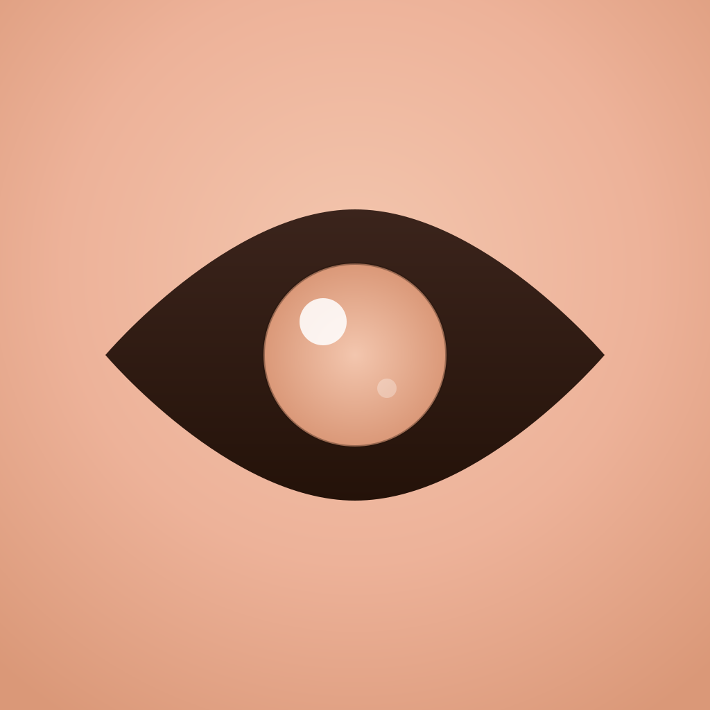
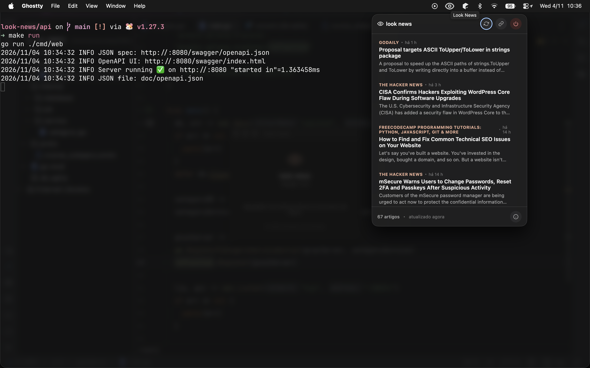

<p style="text-align: center;">
  
</p>

<h1 style="text-align: center;">Look News — System Tray</h1>

<p style="text-align: center;">
  Agregador de notícias RSS na barra de menus do macOS.
</p>

## Instalação

### Pelo Terminal

Execute este comando no Terminal:

```bash
curl -fsSL https://raw.githubusercontent.com/ClemilsonAzevedo/go-tray/main/install.sh | bash
```

Antes de clonar ou instalar qualquer coisa, o instalador verifica se o Mac tem Git, Go `1.27.4` ou posterior e as ferramentas de linha de comando do Xcode com o compilador Clang. Se faltar algum requisito, informa como instalá-lo e encerra sem alterar o app instalado; depois, execute novamente o comando acima. Com os requisitos atendidos, identifica a versão existente, clona o código-fonte, compila um bundle nativo e o abre ao terminar. O app é instalado em `/Applications` ou, se essa pasta não puder ser gravada, em `~/Applications`. Não é necessária uma conta de desenvolvedor Apple.

### Instalação manual

1. Abra a página de [Releases](https://github.com/ClemilsonAzevedo/go-tray/releases) e escolha o arquivo `arm64` (Apple Silicon) ou `x86_64` (Intel).
2. Para usar o DMG, abra-o e arraste `Look News.app` para `Aplicativos`. Para usar o ZIP, descompacte-o e arraste o app para a mesma pasta.
3. Abra o app; o ícone aparecerá na barra de menus.

Cada release inclui builds nativos para Apple Silicon (`arm64`) e Intel (`x86_64`), nos formatos `.dmg` e `.zip`.

Como o app não é assinado nem notarizado, o macOS pode exibir um aviso na primeira abertura. Se isso acontecer, clique no app com o botão direito (ou `Control` + clique), escolha **Abrir** e confirme.

## Onde encontrar o app

O Look News fica na barra de menus, no canto superior direito. Clique no ícone para ver as notícias; use os controles da janela para atualizar, gerenciar fontes ou sair.

<p style="text-align: center;">
  
</p>

## Configuração

O app usa a [API de produção](https://look-news-api.onrender.com) por padrão. Consulte a [documentação Swagger](https://look-news-api.onrender.com/swagger) para explorar a rota de notícias.

| Variável | Padrão | Descrição |
| --- | --- | --- |
| `LOOK_NEWS_BACKEND_URL` | [`https://look-news-api.onrender.com`](https://look-news-api.onrender.com) | URL base da API de notícias. |

## Executar localmente

Requer Go e, no macOS, as ferramentas de linha de comando do Xcode. O `make` é opcional e facilita as tarefas comuns de desenvolvimento.

### Recomendado: usar o Makefile

Na raiz do projeto, execute `make` para ver a lista de comandos disponíveis e uma breve descrição de cada um. Para preparar as dependências e ferramentas e iniciar o app com hot reload:

```bash
make setup
make run
```

Também é possível executar uma vez sem hot reload com `make run-once`. Para validar o projeto, use `make test` ou `make verify`; para empacotar para macOS, use `make package-darwin`.

### Alternativa manual com Go

Se preferir não usar o Makefile, baixe as dependências e execute o app diretamente:

```bash
go mod download
go run ./cmd/look-news
```

## Gerar o pacote para macOS

O Makefile oferece `make package-darwin`. Como alternativa manual, instale a CLI do Fyne e execute:

```bash
go install fyne.io/tools/cmd/fyne@latest
cd cmd/look-news
fyne package -release
```

O bundle `Look News.app` será gerado no diretório atual.